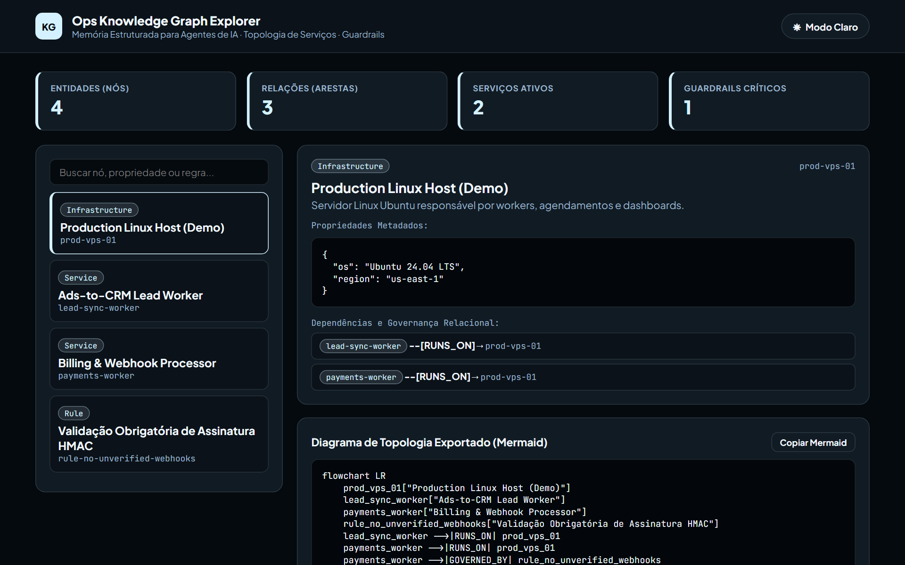

# Ops Knowledge Graph Explorer & CLI (Memória Operacional para Agentes de IA)



Motor leve de **Knowledge Graph local em JSON + Explorador Web (`--serve`) + CLI Python** projetado para dar memória persistente e estruturada a equipes de engenharia e agentes de IA (Claude, Codex, Cursor, Antigravity): mapeia serviços, servidores, integrações, dependências e regras operacionais (*guardrails*) com busca instantânea e exportação de diagrama **Mermaid**.

## Por que este projeto importa?

Em operações com múltiplos microserviços, crons e bots, agentes de IA perdem contexto entre sessões. Este CLI resolve o problema oferecendo uma fonte única de verdade consultável por linha de comando:

```bash
python -m src.cli --summary
python -m src.cli --node payments-worker
python -m src.cli --search oauth
python -m src.cli --rules
python -m src.cli --mermaid
```

## Como Executar

```bash
python -m src.cli --serve   # Abre o Explorador Web em http://127.0.0.1:8026
python -m src.cli --summary
pytest -v
```
